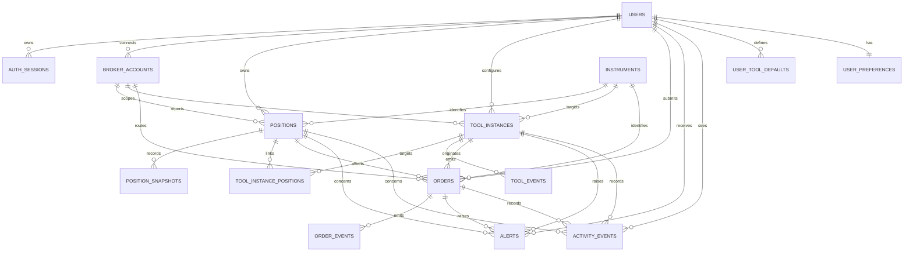

# Trinex database foundation

Neon PostgreSQL is the permanent source of truth. Upstash Redis remains limited
to expiring OTPs, rate limits, caches, locks, and temporary coordination.

All user-owned tables carry an indexed `user_id`. References between user-owned
records use composite `(user_id, id)` foreign keys where needed, preventing a
record from linking to another user's broker account, position, tool, or order.
Application queries must still include the authenticated user's ID; PostgreSQL
row-level security is intentionally deferred until request authentication is
implemented.

All instants use PostgreSQL `TIMESTAMPTZ` and are written in UTC. User and tool
trading-time interpretation defaults to `Asia/Kolkata`.

## Entity relationship diagram

## Tables

### `users`

Application-managed user identity. Phone numbers and normalized email addresses
are unique. Verification, login, status, and soft-deletion timestamps support
account lifecycle without physically deleting trading history.

### `auth_sessions`

Backend authentication sessions owned by a user. Only a unique token hash is
stored, never the raw token. Expiry, revocation, last-seen, device, IP, and user
agent fields support session security and auditing.

### `broker_accounts`

Non-secret broker account identity and connection state. The unique
user/provider/external-account key supports multiple accounts while preventing
duplicates. This table deliberately contains no broker credentials or tokens.

### `instruments`

Global instrument catalogue keyed by exchange and trading symbol. Stores kind,
underlying, expiry, strike, option type, lot size, tick size, currency, active
state, and provider-neutral metadata.

### `positions`

Durable position state for a user and broker account. Numeric columns preserve
quantities, average price, P&L, and margin without floating-point loss. The
broker position key is unique within each user's broker account.

### `position_snapshots`

Append-oriented position observations containing quantity, LTP, P&L, margin,
OHLC values, and JSONB Greeks at a UTC capture time. The position/time pair is
unique and indexed for timeline queries.

### `tool_instances`

Durable armed/configured tool state. `tool_type` is restricted to the eight
Trinex tools, configuration is versioned JSONB, and a GIN index supports future
configuration queries. Execution mode is database-constrained to `paper`.

### `tool_instance_positions`

Tenant-safe many-to-many association for target, trigger, and basket-member
positions. A tool/position/role tuple is unique.

### `orders`

Paper-order intent and lifecycle state with user-scoped idempotency, broker and
instrument identity, quantities, prices, status, and timing. A database check
rejects any execution mode other than `paper`.

### `order_events`

Append-oriented ordered history for an order. Per-order sequence numbers are
unique, and provider payloads are retained as JSONB for diagnostics.

### `tool_events`

Append-oriented lifecycle and trigger history for a tool instance, including a
message, before/after JSONB state, details, and unique per-tool sequence.

### `alerts`

User-facing critical, warning, success, or informational alerts. Optional
position, tool, and order references retain context; dedupe, read, and dismissed
fields support notification workflows.

### `activity_events`

User timeline entries with optional position, tool, and order references,
monetary impact, JSONB metadata, and an indexed UTC occurrence time.

### `user_tool_defaults`

One versioned JSONB default per user and tool type. The tool type uses the same
eight-value constraint as `tool_instances`, with a GIN index on configuration.

### `user_preferences`

One row per user for trading timezone, theme, font size, P&L display, notification
preferences, and paper-only default trading mode. The trading timezone defaults
to `Asia/Kolkata`.

## Tool configuration compatibility

Version 1 retains the exact frontend identifiers and JSON field names for:

1. `timed-exit`
2. `trailing-sl`
3. `timed-entry`
4. `no-motion`
5. `range-break`
6. `partial-profit`
7. `mtm-lock`
8. `dependency`

Backend Pydantic schemas validate these JSONB values without changing the
frontend's string-based numeric inputs or camelCase keys.
